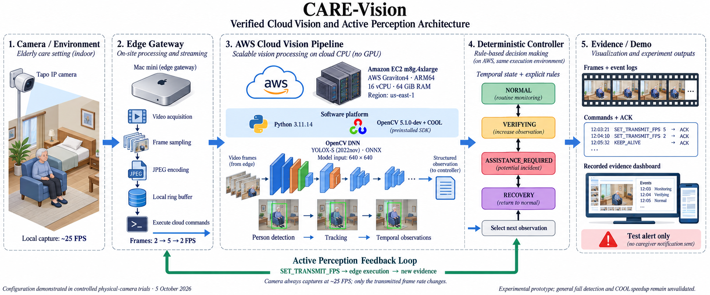

# CARE-Vision

**Adaptive Agentic Vision for Safer Independent Living**

A vision safety-support system for older adults living independently.
OpenCV 5 + COOL runs the core vision workload on AWS Graviton. A deterministic
controller selects subsequent visual evidence through FPS, ROI and buffer
commands to a lightweight Edge Gateway.

Individual project by Victor Ojeda, Argentina, for the OpenCV AI Competition
2026 (COOL and Agentic Vision paths), selected for an AWS Compute Grant.

## See CARE-Vision in two minutes

**[Open the online demo →](https://dqi6ba1tz68v1.cloudfront.net/)**

| Entry | What you can inspect | Execution |
| --- | --- | --- |
| **Caregiver → Recorded episodes** | The same three saved episodes in a focused review: body pose, controller outcome, episode status and test-alert delivery | Public data playback; recorded and replay decisions identified separately |
| **How it works**, Family, Operations; Caregiver → Scenario walkthrough | Interactive examples of the sensing and human-review workflow | Browser-only scenarios with illustrative values |
| **Episode evidence** | Three saved episodes: recovery, a test alert without recovery, and seated closure in replay; body pose, decisions and sensing changes | Public data playback; no key, camera images, video or audio |
| **Technical telemetry** | Runtime, frame counts and command → applied ACK → new-perception chains | New measurements during an operator-led AWS session; read-only visitors need no key |

[Open the Caregiver review](https://dqi6ba1tz68v1.cloudfront.net/#caregiver) to
inspect outcomes without household imagery. Its separate **Scenario walkthrough**
contains simulated human-review actions; those do not change saved episodes.
The recorded evidence and replay decisions are identified in both review views.
Opening the demo does not start a camera, cloud worker or external notification.
A new end-to-end session uses a separately started Edge and an authorized cloud
operator. [Explore the three episodes](https://dqi6ba1tz68v1.cloudfront.net/trials/) ·
[Technical telemetry](https://dqi6ba1tz68v1.cloudfront.net/live).

The public episode view shows body joints on an empty background. Recovery and
no-recovery poses were calculated offline from saved video for presentation;
sitting reuses recorded cloud pose. Original decisions, transport measurements
and cloud processing times are preserved. The view excludes facial landmarks
and original camera pixels; it does not replace visual review of detector accuracy.
[How to inspect the evidence and its scope](docs/public-episode-review.md).

## Run the Local Lab in five minutes

On macOS or Linux, with Python 3.11 and `uv` installed:

```sh
git clone https://github.com/ojedavd/care-vision.git
cd care-vision
uv sync --frozen
uv run --frozen care-lab
```

Choose **Start synthetic run** in the browser. In about 35 seconds, follow a
moving shape through real local Edge/vision processes, measured capture and
transmit rates, agent decisions, applied commands and new visual evidence.
All four perspectives are in English: **Lab & judges**, **Caregiver**, **Family**
and **Operations**. Scripted product walkthroughs are labeled separately from
live measurements; no external notifications are sent.

For a live local test, choose **Local webcam / USB camera** and press
**Start camera**. Preview is optional and memory-only; no camera video is saved.
In this default motion mode the panel states
**THIS COMPUTER · NOT connected to AWS Graviton**. Cloning does
not connect to the owner's instance or replace the deployed CloudFront portal.

No AWS account, camera, model weights or private recordings are needed for the
generated motion demo. [Quick diagnostic guide](docs/local-lab.md).

### Choose a full-pipeline test

| Browser option | Where vision and the agent run | Setup |
| --- | --- | --- |
| **Local · full pipeline** | Separate service on your computer, using standard OpenCV | Run `uv run --frozen care-lab --setup-models`, then choose your camera or local video |
| **My AWS Graviton · COOL** | Your own authorized Graviton with native OpenCV5 + COOL | Prepare your SDK/models, then launch `care-lab --cloud-profile /PRIVATE/cloud-profile.json` |

Both expose real person detection, tracking, temporal policy and pose evidence.
**The local reference does not enable pose-assisted seated closure.** An open
seated episode can remain `UNRESOLVED`; ordinary sitting does not necessarily open
an episode. The default own-Graviton Lab profile also leaves seated closure off.
To run that policy on your Graviton, explicitly configure `seated_closure_seconds`
and independently reviewed scene regions using the [seated-profile steps](docs/full-pipeline-lab.md#4-enable-the-seated-closure-profile-on-your-graviton).
The browser shows whether closure is configured and whether the worker enabled it.
Scene-specific pose actions require reviewed calibration. Model/runtime checks precede camera
acquisition. There is no automatic connection to the owner's AWS account, no
silent fallback and no validated fall-accuracy claim.

[Full setup, model downloads, your own Graviton and verification limits](docs/full-pipeline-lab.md).

## Architecture



*Original diagram illustrating the controlled physical-camera trials of 5 October
2026. Hardware drawings, frames, dashboard and timestamps are schematic examples.
This historical profile does not establish general fall-detection accuracy or a
COOL speedup; see the [technical report](docs/technical-report.md) for measured scope.*

The [approved proposal](docs/approved-proposal.md) remains the architectural
reference. Its original figure is available in the Devpost project gallery;
planned integrations and bandwidth-reduction targets are separate from measured results.

The Edge performs acquisition and transport. Detection, tracking, posture/temporal
analysis and agent decisions execute in AWS. Capture FPS and effective transmitted
FPS are separate quantities. The system preserves uncertainty when evidence or
identity is insufficient; alerts are experimental and test-only.

## Demonstrated seated-closure profile

The source includes the pose-assisted seated closure shown in the 21 October
cloud demonstration. That controlled camera run captured 1,501 frames, sent,
received and processed 140, verified two causal chains, and closed the episode
at source time 24.863 s. It used JPEG full frames at requested 2/5 FPS, native
OpenCV 5 + COOL on Graviton and a five-second, scene-specific seated criterion.
These are results of that development trial, not a new run or an accuracy rate.

[Profile, options and measured limits](docs/demo-profile-20261021.md) ·
[Technical report](docs/technical-report.md) ·
[Source integration checks](docs/obstacle-and-evidence-register.md#24-october--public-source-reconciliation-for-the-demonstrated-seated-closure).

To check the controller's seated-closure behavior and rejection gates without
models, footage or AWS:

```sh
uv run --frozen pytest -q tests/test_seated_closure.py
```

These tests feed synthetic structured observations to the real controller. They
verify policy behavior; they do not execute person/pose inference. For a visual
run, use the explicit own-Graviton profile above. The five-second setting is
uncalibrated and physical seat support is not verified.

## Historical constrained-network regression

The earlier WebP80 / regular-sampling candidate is retained as a separate
historical baseline. Its results below must not be combined with the JPEG
seated-closure trial or interpreted as the default Lab configuration.

The known-development regression used four recordings in five conditions on
Graviton with OpenCV 5 + COOL / CLASSIC, eight threads:

| Measure | Result |
| --- | --- |
| Conditions passing the original auditor | 5 / 5 |
| Frames sent / received / processed | 414 / 414 / 414 |
| Dropped accepted frames / connection errors | 0 / 0 |
| Causal command / ACK / new-perception checks | 20 / 20 |
| Focused tests of the packaged candidate | 26 passing locally |

The constrained profile uses 1280×720, WebP quality 80, regular full-frame sampling
capped at 1.34 FPS, a 112 KiB/s application admission budget and a local TCP proxy
limited to 128 KiB/s before the SSH tunnel. ROI can use a higher requested rate
subject to the byte budget. Requested FPS is not achieved FPS.

These are development-regression results, not independent incident precision,
recall, clinical benefit or general WAN resilience. Quality and sampling changed
together. COOL baseline comparisons have not demonstrated acceleration. Native
SDK installation from a blank host remains to be validated.

[Evaluation and failures](docs/obstacle-and-evidence-register.md) ·
[Technical report](docs/technical-report.md) ·
[Approved proposal text](docs/approved-proposal.md) ·
[Source provenance](docs/source-provenance.json)

## Build and local verification

Python 3.11 and `uv` are required. Dependencies are pinned by `uv.lock`.

```sh
uv sync --frozen
uv run --frozen python tools/check_repository_hygiene.py
uv run --frozen pytest -q tests/test_repository_hygiene.py tests/test_contracts.py tests/test_webp_wire.py tests/test_uniform_budget_sampling.py
uv run --frozen pytest -q tests/test_sampler.py tests/test_commands.py tests/test_controller.py tests/test_spool.py tests/test_closed_loop.py
```

The second test group includes a synthetic local closed-loop test (about 35 seconds).
It uses generated data, no real camera, model weights, AWS connection or private
recording. Standard OpenCV in local tests handles acquisition/representation; it
is not evidence of the core COOL workload running locally.

Historical tests and experiment tools can require external private inputs. The
entire test suite is not a supported data-free acceptance command. The sampler
check can use real capture timestamps only when `CARE_VISION_ASSET_ROOT` is set to
a separately authorized external input root; otherwise it uses a synthetic grid.

## Operator-led cloud review

The deployed [technical telemetry](https://dqi6ba1tz68v1.cloudfront.net/live)
provides public, image-free, read-only metrics. It reports no fresh evidence while
idle. Operator authentication is required to start or stop its bounded AWS worker;
the operator starts the separate Edge and selects the authorized input.

The [public episode view](https://dqi6ba1tz68v1.cloudfront.net/trials/) is a
separate saved-data presentation and requires no key. Original presentation
videos and ROI images remain behind the existing private viewer gate; they are
not needed to open the public episode view.
[Portal implementation](docs/private-judge-portal.md) and
[HTTPS deployment runbook](docs/judge-https-deployment.md) describe the underlying
operator service. The original SSH portal remains available. A prior synthetic
AWS probe achieved 14 FPS against 20 requested; it is separate from the frozen
WebP80 regression and from the seated camera trial.

## AWS deployment

[Deployment instructions](docs/portable-cloud-runtime-20261017.md) describe the
separate locked cloud environment and external COOL SDK. Keep standard OpenCV
wheels out of that cloud environment. Models, SDK entitlement and scene calibration
must be supplied separately. Services bind to loopback and use an authenticated
SSH tunnel. CloudFront serves the public walkthrough, episode data view and
read-only telemetry, plus the protected original trial viewer. Vision WebSockets stay on loopback. This
repository supplies no account credentials, model weights or private origin addresses.

The experimental runner requires an explicit budget and an external frozen
input/source profile. A prepare-only invocation contacts no AWS host:

```sh
CARE_DIAGNOSTIC_BYTE_BUDGET=114688 uv run --frozen python tools/run_portable_classic_replays.py --asset-root /PRIVATE/INPUT_ROOT --profile /PRIVATE/FROZEN_PROFILE.json --output /PRIVATE/new-preflight --prepare-only
```

The profile, model weights and original development recordings are deliberately
absent from GitHub. A profile must match this source and its separately supplied
inputs. Documentation of a prior evaluation does not grant access to those inputs.
No live camera, external caregiver alert or AWS job starts by cloning/building.

## Privacy: recordings stay local

**Do not upload any old or new test video.** Record new scenes outside this
repository, using an absolute output path in a private workspace. No recordings,
personal images, audio, observations, logs, snapshots, model weights, SDK binaries, keys or
personal deployment files are distributed here.

The two reviewed architecture assets in `docs/images/` are the only media exceptions;
only the illustrated diagram is displayed in this README.
`.gitignore` excludes private media; source-only checks reject unsupported files,
media signatures and obvious credentials even if a file is force-added or renamed.
Install local protection before development:

```sh
# Install gitleaks separately; for example, on macOS:
brew install gitleaks
git config --local core.hooksPath .githooks
```

The pre-commit hook scans staged content. The pre-push hook checks committed
history as well, so deleting a private file in a later commit is insufficient.
[Security and sharing procedure](SECURITY.md).

This repository and the online episode data view are public. Original recordings,
operator controls and private evaluation inputs remain access controlled;
access to those inputs must be arranged separately. No open-source license has been selected;
third-party dependencies/assets retain their own terms.
