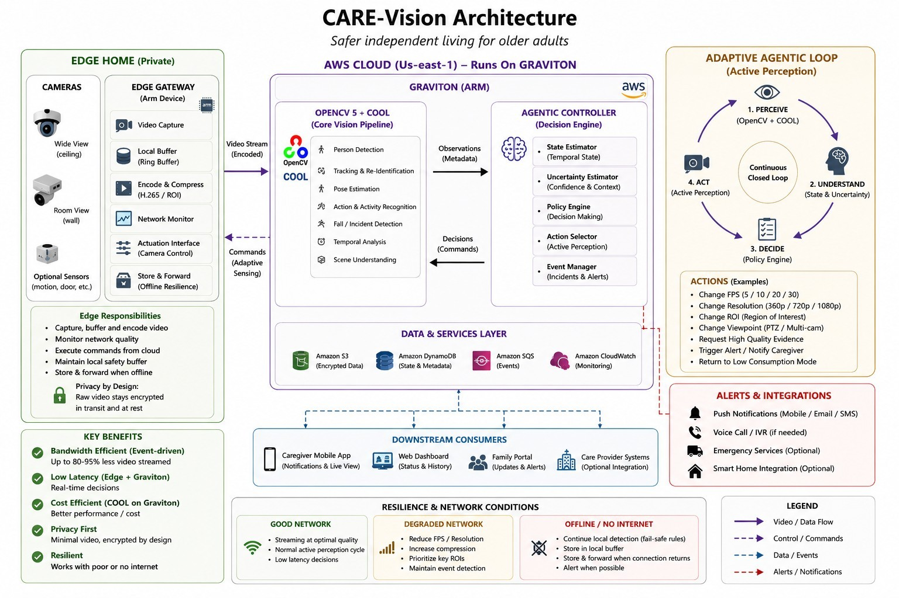
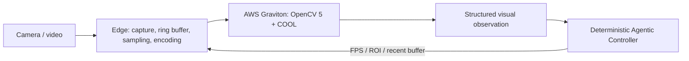

> Demonstrated seated profile: the source now includes the experimental pose-assisted closure shown in the 21 October demo. Read the [profile and configuration](docs/demo-profile-20261021.md), [technical report](docs/technical-report.md) and [integration checks](docs/obstacle-and-evidence-register.md#24-october--public-source-reconciliation-for-the-demonstrated-seated-closure). Closure is off by default; the five-second threshold is uncalibrated. Historical WebP capped regression results below describe a different profile.

# CARE-Vision

**Adaptive Agentic Vision for Safer Independent Living**

An experimental safety-support system for older adults living independently.
OpenCV 5 + COOL runs the core vision workload on AWS Graviton. A deterministic
controller selects subsequent visual evidence through FPS, ROI and buffer
commands to a lightweight Edge Gateway.

Individual project by Victor Ojeda, Argentina, for the OpenCV AI Competition
2026 (COOL and Agentic Vision paths), selected for an AWS Compute Grant.

## Try the visual Local Lab

On macOS or Linux, with Python 3.11 and `uv` installed:

```sh
git clone https://github.com/ojedavd/care-vision.git
cd care-vision
uv sync --frozen
uv run --frozen care-lab
```

Choose **Start synthetic run** in the browser. In about 35 seconds, follow a
moving shape through real local Edge/vision processes, measured capture and
transmit rates, agent decisions, applied commands and new visual evidence.
All four perspectives are in English: **Lab & judges**, **Caregiver**, **Family**
and **Operations**. Scripted product walkthroughs are labeled separately from
live measurements; no external notifications are sent.

For a live local test, choose **Local webcam / USB camera** and press
**Start camera**. Preview is optional and memory-only; no camera video is saved.
In this default motion mode the panel states
**THIS COMPUTER · NOT connected to AWS Graviton**. Cloning does
not connect to the owner's instance or replace the deployed CloudFront portal.

No AWS account, camera, model weights or private recordings are needed for the
generated motion demo. [Quick diagnostic guide](docs/local-lab.md).

### Choose a full-pipeline test

| Browser option | Where vision and the agent run | Setup |
| --- | --- | --- |
| **Local · full pipeline** | Separate service on your computer, using standard OpenCV | Run `uv run --frozen care-lab --setup-models`, then choose your camera or local video |
| **My AWS Graviton · COOL** | Your own authorized Graviton with native OpenCV5 + COOL | Prepare your SDK/models, then launch `care-lab --cloud-profile /PRIVATE/cloud-profile.json` |

Both expose real person detection, tracking, temporal policy and pose evidence.
The local mode is a functional reference with passive pose; scene-specific AWS
pose actions require reviewed calibration. Model/runtime checks precede camera
acquisition. There is no automatic connection to the owner's AWS account, no
silent fallback and no validated fall-accuracy claim.

[Full setup, model downloads, your own Graviton and verification limits](docs/full-pipeline-lab.md).

## Architecture

### Illustrated experimental architecture


*Original diagram illustrating the controlled physical-camera trials of 5 October
2026. Hardware drawings, frames, dashboard and timestamps are schematic examples.
This historical profile does not establish general fall-detection accuracy or a
COOL speedup; see the [technical report](docs/technical-report.md) for measured scope.*

### Approved proposal



*Original Figure 1 from the approved proposal (page 5). This depicts planned
scope, including future services and integrations. The 80–95% reduction shown is
an initial target, not a measured result; offline cloud vision is unavailable.
The Edge remains responsible for acquisition and transport, with primary CV on
Graviton. See the [proposal text](docs/approved-proposal.md) and measured scope below.*



The Edge performs acquisition and transport. Detection, tracking, posture/temporal
analysis and agent decisions execute in AWS. Capture FPS and effective transmitted
FPS are separate quantities. The system preserves uncertainty when evidence or
identity is insufficient; alerts are experimental and test-only.

## Current source and measured scope

This repository starts from the experimentally evaluated WebP80 / regular-sampling
candidate, derived from the archived v4 code. The original core modules match that candidate;
publication adds documentation, privacy checks, parameterized connection settings
in five historical tools and a capture-time-based assertion in a historical test. It is a separate code-only workspace.

The known-development regression used four recordings in five conditions on
Graviton with OpenCV 5 + COOL / CLASSIC, eight threads:

| Measure | Result |
| --- | --- |
| Conditions passing the original auditor | 5 / 5 |
| Frames sent / received / processed | 414 / 414 / 414 |
| Dropped accepted frames / connection errors | 0 / 0 |
| Causal command / ACK / new-perception checks | 20 / 20 |
| Focused tests of the packaged candidate | 26 passing locally |

The constrained profile uses 1280×720, WebP quality 80, regular full-frame sampling
capped at 1.34 FPS, a 112 KiB/s application admission budget and a local TCP proxy
limited to 128 KiB/s before the SSH tunnel. ROI can use a higher requested rate
subject to the byte budget. Requested FPS is not achieved FPS.

These are development-regression results, not independent incident precision,
recall, clinical benefit or general WAN resilience. Quality and sampling changed
together. COOL baseline comparisons have not demonstrated acceleration. Native
SDK installation from a blank host remains to be validated.

[Evaluation and failures](docs/obstacle-and-evidence-register.md) ·
[Technical report](docs/technical-report.md) ·
[Approved proposal text](docs/approved-proposal.md) ·
[Source provenance](docs/source-provenance.json)

## Build and local verification

Python 3.11 and `uv` are required. Dependencies are pinned by `uv.lock`.

```sh
uv sync --frozen
uv run --frozen python tools/check_repository_hygiene.py
uv run --frozen pytest -q tests/test_repository_hygiene.py tests/test_contracts.py tests/test_webp_wire.py tests/test_uniform_budget_sampling.py
uv run --frozen pytest -q tests/test_sampler.py tests/test_commands.py tests/test_controller.py tests/test_spool.py tests/test_closed_loop.py
```

The second test group includes a synthetic local closed-loop test (about 35 seconds).
It uses generated data, no real camera, model weights, AWS connection or private
recording. Standard OpenCV in local tests handles acquisition/representation; it
is not evidence of the core COOL workload running locally.

Historical tests and experiment tools can require external private inputs. The
entire test suite is not a supported data-free acceptance command. The sampler
check can use real capture timestamps only when `CARE_VISION_ASSET_ROOT` is set to
a separately authorized external input root; otherwise it uses a synthetic grid.

## Private live review application

A separate [judge portal](docs/private-judge-portal.md) can launch bounded cloud
sessions and display allowlisted runtime metrics and the perception/action chain.
A separate supervised [CloudFront/VPC-origin HTTPS entry](docs/judge-https-deployment.md)
is deployed and externally verified. Viewer/operator access remains authenticated;
judge credentials and repository access are supplied separately. The original SSH
portal remains available. See the runbook for measured checks and retained limits.
Start session launches only the AWS worker; the operator starts the local Edge
and selects an authorized source separately. There is no automatic recording
playback or camera start. It serves no images or recordings. The original
evaluated core modules are unchanged. The new guided synthetic AWS probe executed COOL but failed the full
20FPS rate audit (14FPS achieved); it is not the frozen WebP80 regression.

## AWS deployment

[Deployment instructions](docs/portable-cloud-runtime-20261017.md) describe the
separate locked cloud environment and external COOL SDK. Keep standard OpenCV
wheels out of that cloud environment. Models, SDK entitlement and scene calibration
must be supplied separately. Services bind to loopback and use an authenticated
SSH tunnel. The HTTPS entry exposes only the authenticated, image-free review
portal; vision WebSockets stay on loopback. This repository supplies no account
credentials, model weights or personal deployment identifiers.

The experimental runner requires an explicit budget and an external frozen
input/source profile. A prepare-only invocation contacts no AWS host:

```sh
CARE_DIAGNOSTIC_BYTE_BUDGET=114688 uv run --frozen python tools/run_portable_classic_replays.py --asset-root /PRIVATE/INPUT_ROOT --profile /PRIVATE/FROZEN_PROFILE.json --output /PRIVATE/new-preflight --prepare-only
```

The profile, model weights and original development recordings are deliberately
absent from GitHub. A profile must match this source and its separately supplied
inputs. Documentation of a prior evaluation does not grant access to those inputs.
No live camera, external caregiver alert or AWS job starts by cloning/building.

## Privacy: recordings stay local

**Do not upload any old or new test video.** Record new scenes outside this
repository, using an absolute output path in a private workspace. No recordings,
personal images, audio, observations, logs, snapshots, model weights, SDK binaries, keys or
personal deployment files are distributed here.

The two reviewed architecture diagrams above are the only media exceptions.
`.gitignore` excludes private media; source-only checks reject unsupported files,
media signatures and obvious credentials even if a file is force-added or renamed.
Install local protection before development:

```sh
# Install gitleaks separately; for example, on macOS:
brew install gitleaks
git config --local core.hooksPath .githooks
```

The pre-commit hook scans staged content. The pre-push hook checks committed
history as well, so deleting a private file in a later commit is insufficient.
[Security and sharing procedure](SECURITY.md).

This repository is public. Access to the authenticated judge portal and private
evaluation inputs must still be supplied separately to authorized judges. No open-source license has been selected;
third-party dependencies/assets retain their own terms.
