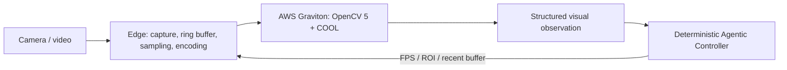

# CARE-Vision

**Adaptive Agentic Vision for Safer Independent Living**

An experimental safety-support system for older adults living independently.
OpenCV 5 + COOL runs the core vision workload on AWS Graviton. A deterministic
controller selects subsequent visual evidence through FPS, ROI and buffer
commands to a lightweight Edge Gateway.

Individual project by Victor Ojeda, Argentina, for the OpenCV AI Competition
2026 (COOL and Agentic Vision paths), selected for an AWS Compute Grant.

## Architecture



The Edge performs acquisition and transport. Detection, tracking, posture/temporal
analysis and agent decisions execute in AWS. Capture FPS and effective transmitted
FPS are separate quantities. The system preserves uncertainty when evidence or
identity is insufficient; alerts are experimental and test-only.

## Current source and measured scope

This repository starts from the experimentally evaluated WebP80 / regular-sampling
candidate, derived from the archived v4 code. The original core modules match that candidate;
publication adds documentation, privacy checks, parameterized connection settings
in five historical tools and a capture-time-based assertion in a historical test. It is a separate code-only workspace.

The known-development regression used four recordings in five conditions on
Graviton with OpenCV 5 + COOL / CLASSIC, eight threads:

| Measure | Result |
| --- | --- |
| Conditions passing the original auditor | 5 / 5 |
| Frames sent / received / processed | 414 / 414 / 414 |
| Dropped accepted frames / connection errors | 0 / 0 |
| Causal command / ACK / new-perception checks | 20 / 20 |
| Focused tests of the packaged candidate | 26 passing locally |

The constrained profile uses 1280×720, WebP quality 80, regular full-frame sampling
capped at 1.34 FPS, a 112 KiB/s application admission budget and a local TCP proxy
limited to 128 KiB/s before the SSH tunnel. ROI can use a higher requested rate
subject to the byte budget. Requested FPS is not achieved FPS.

These are development-regression results, not independent incident precision,
recall, clinical benefit or general WAN resilience. Quality and sampling changed
together. COOL baseline comparisons have not demonstrated acceleration. Native
SDK installation from a blank host remains to be validated.

[Evaluation and failures](docs/obstacle-and-evidence-register.md) ·
[Technical report](docs/technical-report.md) ·
[Approved proposal text](docs/approved-proposal.md) ·
[Source provenance](docs/source-provenance.json)

## Build and local verification

Python 3.11 and `uv` are required. Dependencies are pinned by `uv.lock`.

```sh
uv sync --frozen
uv run --frozen python tools/check_repository_hygiene.py
uv run --frozen pytest -q tests/test_repository_hygiene.py tests/test_contracts.py tests/test_webp_wire.py tests/test_uniform_budget_sampling.py
uv run --frozen pytest -q tests/test_sampler.py tests/test_commands.py tests/test_controller.py tests/test_spool.py tests/test_closed_loop.py
```

The second test group includes a synthetic local closed-loop test (about 35 seconds).
It uses generated data, no real camera, model weights, AWS connection or private
recording. Standard OpenCV in local tests handles acquisition/representation; it
is not evidence of the core COOL workload running locally.

Historical tests and experiment tools can require external private inputs. The
entire test suite is not a supported data-free acceptance command. The sampler
check can use real capture timestamps only when `CARE_VISION_ASSET_ROOT` is set to
a separately authorized external input root; otherwise it uses a synthetic grid.

## Private live review application

A separate [judge portal](docs/private-judge-portal.md) can launch bounded cloud
sessions and display allowlisted runtime metrics and the perception/action chain.
The first deployment is private via SSH; an external HTTPS endpoint is pending.
A [disabled CloudFront/VPC-origin plan](docs/judge-https-deployment.md) is prepared
and locally validated; it has not been deployed or verified in the AWS account.
It serves no images or recordings. The original evaluated core modules are
unchanged. The new guided synthetic AWS probe executed COOL but failed the full
20FPS rate audit (14FPS achieved); it is not the frozen WebP80 regression.

## AWS deployment

[Deployment instructions](docs/portable-cloud-runtime-20261017.md) describe the
separate locked cloud environment and external COOL SDK. Keep standard OpenCV
wheels out of that cloud environment. Models, SDK entitlement and scene calibration
must be supplied separately. Services bind to loopback and use an authenticated
SSH tunnel; this repository supplies no public endpoint or account credentials.

The experimental runner requires an explicit budget and an external frozen
input/source profile. A prepare-only invocation contacts no AWS host:

```sh
CARE_DIAGNOSTIC_BYTE_BUDGET=114688 uv run --frozen python tools/run_portable_classic_replays.py --asset-root /PRIVATE/INPUT_ROOT --profile /PRIVATE/FROZEN_PROFILE.json --output /PRIVATE/new-preflight --prepare-only
```

The profile, model weights and original development recordings are deliberately
absent from GitHub. A profile must match this source and its separately supplied
inputs. Documentation of a prior evaluation does not grant access to those inputs.
No live camera, external caregiver alert or AWS job starts by cloning/building.

## Privacy: recordings stay local

**Do not upload any old or new test video.** Record new scenes outside this
repository, using an absolute output path in a private workspace. No recordings,
images, audio, observations, logs, snapshots, model weights, SDK binaries, keys or
personal deployment files are distributed here.

`.gitignore` excludes these files; source-only checks reject unsupported files,
media signatures and obvious credentials even if a file is force-added or renamed.
Install local protection before development:

```sh
# Install gitleaks separately; for example, on macOS:
brew install gitleaks
git config --local core.hooksPath .githooks
```

The pre-commit hook scans staged content. The pre-push hook checks committed
history as well, so deleting a private file in a later commit is insufficient.
[Security and sharing procedure](SECURITY.md).

Private GitHub access must be explicitly granted to authorized judges. A repository
URL alone does not give them access. No open-source license has been selected;
third-party dependencies/assets retain their own terms.
