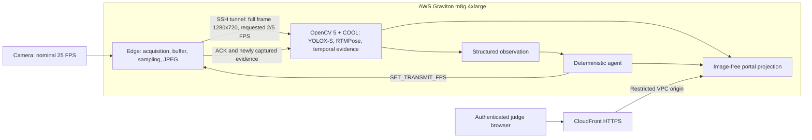
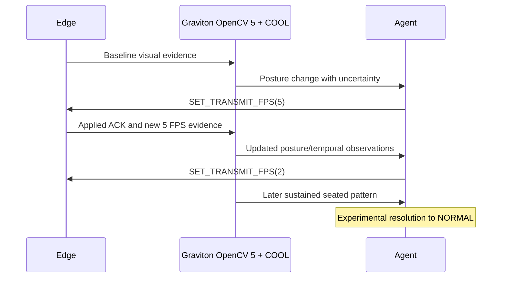

# Current architecture and agentic workflow

Selected demonstration profile, 21 October 2026. Capture and transmission rates
are independent. The primary inference and deterministic controller remain on AWS
Graviton. Other AWS services listed in the proposal are not claimed as deployed.

ROI/buffer actions exist in other profiles; they are not exercised in this trial.
Alerts are disabled. Refer to technical-report.md for measurements and limitations.
