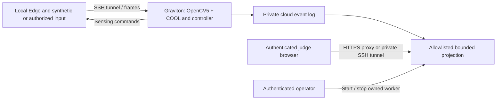

# Private live review portal

The portal observes and starts an isolated cloud worker. Detection, tracking and
agent policy remain in the existing Graviton/OpenCV5/COOL process. No inference
moves to the browser or Edge. It is a guided review interface, not a caregiver
service or an autonomous judge replay library.



## What is available

- Viewer and operator credentials, stored outside the checkout. Viewers cannot
  start/stop workers. Credentials currently identify roles, not individual accounts.
- HttpOnly/SameSite cookies, half-hour sessions, Origin/Host and CSRF checks,
  bounded login attempts, no-store responses and no access/request logging.
- A loopback-only service: raw logs, arbitrary files, images, recordings and
  per-person identifiers have no HTTP route. An unknown route cannot expose files.
- Private per-run directories, 40–600 second worker limits, process-group
  stop, stale-evidence visibility and truthful local-versus-COOL runtime labels.
- Counters, cloud processing cadence/latency, requested FPS, CPU/RSS and causal
  indicators. A completed live indicator requires an observed source observation,
  an action referring to it, an applied/duplicate ACK and subsequent valid live
  evidence naming that command. Historical observations do not refresh live status.
- Historical buffer commands appear on the timeline but their complete transfer
  validation remains the responsibility of the original regression auditor.

Capture FPS, actual Edge transmit FPS and transmitted bytes are not available in
this cloud-only projection. They remain explicitly unavailable, rather than being
substituted by requested FPS or cloud processing rate. Total/live/historical frame
counts are distinct. Process CPU 100% means one occupied core, not the whole host.

## Local synthetic verification

Create a **private external** credentials JSON with exactly `operator` and `viewer`,
each a different random secret of at least 32 characters. Use an OS credential tool
or Python `secrets.token_urlsafe(36)`. Do not print secrets into a terminal recording,
put them in URLs, pass them as command-line arguments or commit them. Set mode0600.
The state directory must also be outside the code checkout.

```sh
uv sync --frozen
uv run --frozen python -m care_vision.judge --synthetic-local --credentials-file /PRIVATE/access.json --state-root /PRIVATE/judge-sessions --port 8780 --seconds 60
uv run --frozen pytest -q tests/test_judge_portal.py
```

Open `http://127.0.0.1:8780`, sign in locally and start a session. The generated
geometric-motion fixture runs the actual local Edge/cloud processes. The page
labels it **SYNTHETIC_LOCAL_NOT_COOL**. It provides no person/fall accuracy evidence.
Stop terminates only the owned process group. A background watchdog enforces the
worker limit even if all viewers close their browser. The portal itself stays up.

## Cloud preparation and guided run

Use the locked cloud environment described in
[the runtime guide](portable-cloud-runtime-20261017.md). Keep standard OpenCV wheels
out of it. External entitled COOL and models are not supplied by this repository.
Preserve a virtual environment Python path: resolving its symlink to system Python
would lose the selected environment.

```sh
PYTHONPATH=/DEPLOY/src /DEPLOY/.venv/bin/python -m care_vision.judge --credentials-file /PRIVATE/access.json --state-root /PRIVATE/judge-sessions --cloud-python /DEPLOY/.venv/bin/python --cloud-source /DEPLOY --port 8780 --seconds 120
```

The portal explicitly launches phase3 on127.0.0.1 with an ephemeral WebSocket port.
Before `server_ready`, the worker verifies EC2 ARM64 and the COOL native runtime.
With no model configuration, it is explicitly a **COOL motion/transport probe**;
it must not be presented as person or fall detection. No camera or personal input
starts automatically. Connect the operator's local Edge only after authorization.

For a full person/pose workflow, `--cloud-options /PRIVATE/options.json` accepts a
small allowlist of existing cloud options: person model/detector/input size,
CLASSIC engine, S-only, weak association, episode continuity, pose config/action,
and explicit experimental test-alert duration. Models and scene context remain
external. Review them against the frozen evaluation profile. The portal does not
change detection thresholds or resolve identity uncertainty. Its launch can differ
from the frozen WebP80 runner, so that regression result does not transfer to it.
There is no persistent episode-state configuration in this first portal launcher;
closing a demo does not establish an incident outcome or production recovery.

To review through SSH, forward the same local port8780 to remote loopback8780,
using an existing trusted host/key. The operator can see the current cloud port
and create a second loopback tunnel for the Edge. Viewers do not receive that port.
Keep SSH host-key verification enabled. All credentials stay outside GitHub.

## External HTTPS remains a separate deployment step

Do not open port8780 directly to the Internet or expose the private experiment
file server. Configure a trusted HTTPS reverse proxy with the exact public origin:

```sh
# Append this only after the proxy and host are configured:
--https-origin https://review.example.org
```

The proxy must preserve `Host` and forward browser `Origin`, cookies, JSON POSTs
and CSRF headers unchanged. Do not cache any portal response or log request bodies,
cookies or authorization information. TLS must terminate at a trusted entry point;
never send login credentials over an unprotected public origin connection.

With an owned DNS name, a small reverse proxy alongside the existing host is the
simplest route; certificate/domain ownership and restricted ingress must be verified.
[Automatic HTTPS documentation](https://caddyserver.com/docs/automatic-https).
Without a domain, an AWS-managed HTTPS hostname can use a separately reviewed
CloudFront design. [VPC origins](https://docs.aws.amazon.com/AmazonCloudFront/latest/DeveloperGuide/private-content-vpc-origins.html)
can keep an EC2 origin private, but require compatible subnets/security groups;
they are not provisioned by this package. Do not change an existing shared subnet
or expose its services merely to make that design fit.

Before adding a Devpost working endpoint, verify HTTPS from a separate device,
viewer isolation, cookie/security headers, cache behavior, start/stop/timeout,
network loss and the exact chosen vision profile. Private judge access is not
satisfied by a repository link or by a loopback URL.

## Measured first deployment scope and limitations

The initial isolated Graviton deployment was verified through a private SSH tunnel,
using generated geometric input from the local Edge; no personal video was used
or uploaded. The first worker launch failed due to a resolved virtualenv symlink;
the selected interpreter is now preserved. The UI correctly showed FAILED/no live
vision. A uv preflight also rejected a valid pinned version with a platform suffix;
the private setup procedure now compares version tokens.

The subsequent phase3 run loaded COOL and processed383/383 received frames with
zero declared drops, displaying two completed live command cycles and returning to
NORMAL. **The full loop auditor failed** its 20FPS target check: achieved14FPS.
This is a real network/throughput limitation of this guided probe, not a passed
full regression, a COOL speedup result, or incident accuracy evidence. Its source
and launch differ from the frozen WebP80/byte-budget profile. Personal clips,
independent incident validation, per-person credentials, visual previews and an
external HTTPS endpoint remain outside this verified first deployment.
