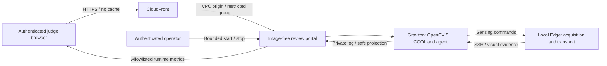

# CARE-Vision — technical report summary

Code-only publication summary, updated 19 October 2026. Personal evidence and deployment
identifiers are omitted. See the source provenance and evaluation register.

## Inspiration

Independent living creates a difficult safety trade-off: a possible incident may need more visual evidence, while continuous high-quality monitoring consumes bandwidth, cloud compute, and privacy. CARE-Vision explores whether a vision system can decide what it should observe next before escalating a concern.

The intended beneficiaries are older adults living independently and the people who support them. The current application is an experimental safety-support prototype. Its evaluation uses development recordings; incident accuracy in the intended population remains unmeasured.

## What it does

CARE-Vision maintains a perception–decision–action loop. A lightweight Edge Gateway captures video, maintains a dense rolling buffer, samples frames, and executes sensing commands. The main computer vision workload and a deterministic Agentic Controller run on AWS Graviton using OpenCV 5 + COOL.

Visual observations can cause the controller to request a different transmission rate, a person region of interest, a full frame, or recent buffered evidence. New evidence is processed again before the controller continues observing, records recovery, or emits an explicitly enabled test alert. Camera capture rate and effective transmission rate are tracked separately.

Camera/video → Edge sampling and buffer → AWS Graviton / OpenCV 5 + COOL → structured observation → agent decision → sensing command → new visual evidence

## How I built it

I built CARE-Vision as an individual project in Argentina, supported by an AWS Compute Grant for the OpenCV AI Competition 2026.

The implementation uses Python, persistent WebSocket communication, bounded queues, capture timestamps, and explicit command acknowledgements. The cloud pipeline combines person detection and tracking, posture and temporal evidence, and an experimental pose-assisted ROI workflow. The evaluated cloud configuration uses an m8g.4xlarge Graviton instance, an OpenCV 5 development build supplied with the COOL SDK, YOLOX-S with the CLASSIC engine, and eight OpenCV threads.

The controller uses reproducible rules and temporal state. Each sensing action is linked to the observation that caused it, its acknowledgement, and subsequent visual observations. The gateway performs acquisition, representation, encoding, and transport; inference remains in AWS.

## Judge-facing AWS deployment

A separate authenticated, image-free review portal is supervised on the existing
Graviton instance. CloudFront supplies the managed HTTPS hostname and certificate;
a VPC origin reaches only the private-interface portal port through the verified
AWS-managed origin security group. The existing publicly routed subnet, instance
address, SSH group and CV worker boundary were preserved. The vision WebSocket
remains loopback-only and the local Edge connects through the authorized SSH path.

External checks verified authentication/role isolation, trusted HTTPS, no cache,
CSRF/Origin controls, private-file denial and worker lifecycle. The real phase3
worker self-terminated at its native120-second limit, then restarted and stopped.
The approved existing person-model hash matched and native CLASSIC inference on a
generated blank frame returned zero people. These checks used no personal videos
or camera and do not validate person/incident accuracy. The new portal's person
configuration has no inherited pose/scene calibration and is not the complete
frozen sensing profile. The earlier geometric motion/transport portal probe
failed its full rate audit at14FPS versus20 requested; HTTPS does not resolve it.
Details and failed harness expectations are retained in the
[HTTPS runbook](judge-https-deployment.md) and evaluation register.

## Results so far

The latest constrained-network development experiment evaluated five conditions across four existing recordings: recovery, continued observation without recovery, a separate test-alert condition, and two posture/ROI scenarios.

- All five conditions passed the original regression auditor.
- 414 frames were sent, received, and processed, with no declared frame drops or connection errors in these runs.
- All 20 checked commands passed causality, acknowledgement, and subsequent-perception checks.
- The test-alert condition reached ASSISTANCE_REQUIRED after sufficient accumulated visual evidence; the alert was test-only.
- Recovery required sustained evidence from the same tracked person. Uncertain identity kept the episode open.
- The packaged candidate passed 26 focused local tests from a fresh source extraction, using the existing local dependency environment.

This experimental profile uses 1280×720 images, WebP quality 80, and a regular full-frame transmission cap of 1.34 FPS. ROI transmission can use a higher requested rate subject to the byte budget. Application admission was limited to 112 KiB/s and a local TCP proxy before the SSH tunnel to 128 KiB/s. These are controlled-link results; requested FPS is reported separately from achieved FPS.

These results establish regression behavior on known development recordings. Independent incident precision, recall, clinical benefit, and general network resilience remain to be evaluated.

## Challenges and lessons learned

A stalled pong exposed how transport backlog can interrupt an otherwise responsive vision pipeline. Reducing bytes alone was insufficient: a JPEG quality-25 profile missed the expected test alert, and a WebP quality-50 profile lost the original track and could not establish recovery. Both profiles passed transport checks but failed one functional condition.

The later higher-quality, regularly sampled profile passed all five conditions. Quality and sampling changed together, so these experiments do not isolate the contribution of either factor. Earlier failures remain part of the evidence.

COOL execution on Graviton is documented. The baseline comparisons have not demonstrated a COOL speedup. The native SDK was already installed on the evaluation host, and provisioning it from a blank environment remains an open reproducibility limitation.

## Responsible use and next steps

CARE-Vision is a research prototype for safety support. Medical diagnosis, validated fall detection, and guaranteed caregiver assistance are outside its demonstrated scope. Alerts remain test-only, with no external caregiver notification. Missing evidence, connectivity loss, or a new person identity must not be treated as proof of recovery.

Presentation copies can apply head blur after inference; this does not anonymize the original inputs or automatically protect a live screen-share. Personal recordings remain restricted to authorized private judge access.

Next steps are to freeze the chosen delivery profile, evaluate newly recorded everyday activities with annotations defined before examining predictions, strengthen network and uncertainty evaluation, and rehearse the final judge demonstration. The implementation, measured limitations, and failed experiments are documented alongside pinned dependencies and reproducible run instructions.

## Subsequent recorded-source portal check

Known local recordings were also streamed through the actual HTTPS-portal-owned
person-only Graviton worker. Four completed constrained sessions processed324/324
frames with14 causal command chains, after one retained interrupted attempt with
an undetermined cause. The frozen full person/pose configuration was not enabled.
A separate original-Edge/JPEG recovery run processed140/140 frames and measured
live transmission changing from approximately2 to5 and back to2FPS, with nominal
25FPS acquisition preserved. This verifies an achieved sensing change on that
connection, not a general bandwidth, clinical-accuracy or COOL-acceleration result.
The [evidence register](obstacle-and-evidence-register.md) retains both the
interruption and profile differences. The portal's native end-of-stream freshness
indicator was corrected separately; CV decisions and thresholds were unchanged.
